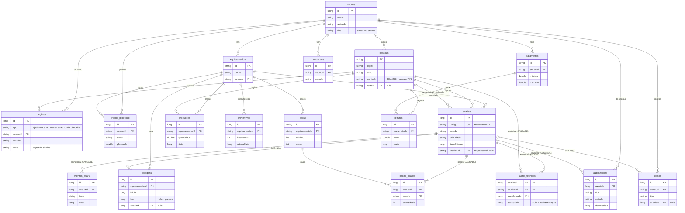

# FinsaFix

Aplicação Android de gestão de avarias e manutenção para tablets de parede numa fábrica de painéis de madeira.

Trabalho prático individual · Programação de Dispositivos Móveis · Universidade da Beira Interior

> Projeto académico inspirado na fábrica Luso Finsa de Nelas. Não é uma aplicação oficial da empresa: os nomes, PINs e dados são fictícios.

**Índice:** [Descrição](#descrição) · [Funcionalidades](#funcionalidades) · [Como abrir, compilar e testar](#como-abrir-compilar-e-testar) · [Tecnologia de armazenamento](#tecnologia-de-armazenamento) · [Estrutura dos dados](#estrutura-dos-dados) · [Requisitos do enunciado](#requisitos-do-enunciado) · [Decisões de implementação](#decisões-de-implementação) · [Bibliotecas externas](#bibliotecas-externas-e-justificação) · [Dificuldades](#dificuldades) · [Funcionalidades adicionais](#funcionalidades-adicionais) · [Limitações e trabalho futuro](#limitações-e-trabalho-futuro) · [Uso de inteligência artificial](#uso-de-inteligência-artificial) · [Entrega](#entrega)

## Descrição

Numa fábrica, as avarias são muitas vezes comunicadas de boca ou em papel: perde-se informação, não se sabe quem está a tratar de cada uma e o operador não sabe quando pode voltar a ligar a máquina.

O FinsaFix resolve isto com um tablet de parede em cada secção e em cada oficina. Quem está ao serviço toca no seu nome e reporta ou trata avarias. A interface foi pensada para operadores com pouca experiência: botões grandes, poucas palavras e estados sempre com ícone, texto e cor. A aplicação funciona **sem Internet** e guarda tudo no próprio dispositivo, numa base de dados **Room**.

O registo principal é a **Avaria**: identificador único (`id` e código `AV-2026-0418`), equipamento, título, descrição, prioridade, especialidade, estado e datas de criação, início e fim da intervenção.

## Funcionalidades

**Ciclo completo da avaria (o núcleo pedido pelo enunciado)**
- Reportar uma avaria num assistente de 5 passos (equipamento, tipo, sintoma, urgência, confirmar), com validação em cada passo.
- Listar as avarias da secção ou da oficina, com filtros, contagens e pesquisa.
- Ver o detalhe de uma avaria, com a cronologia de quem fez o quê.
- Editar uma avaria enquanto está pendente (só quem a reportou).
- Eliminar com confirmação e motivo, e "Desfazer" durante 10 s.
- Os dados ficam guardados depois de fechar a aplicação e de reiniciar o dispositivo.

**Por perfil**

| Perfil | Como entra | O que pode fazer |
| --- | --- | --- |
| Operador | Toca no seu nome | Reportar avarias; registar paragens, produção e leituras de parâmetros; checklist de arranque do turno; pedir ajuda ou material; instruções de trabalho; notas de passagem de turno; histórico |
| Técnico | Toca no seu nome, no tablet da oficina | Assumir uma avaria (com os 3 pontos de segurança LOTO), concluir ou deixar em progresso com uma nota; juntar-se a uma intervenção de outro técnico; pedir autorizações de trabalho; avisar a secção; registar peças; preventiva, rondas e stock |
| Chefe de secção | Cadeado e PIN, só no tablet da sua secção | Estado da secção e "Por tratar"; responder a pedidos; aprovar ou recusar autorizações (checklist e PIN); plano do turno; resumo do turno |
| Chefe de oficina | Cadeado e PIN, no tablet da sua oficina | Estado da oficina; distribuir avarias por um técnico responsável e ajudantes; ver a equipa e o que cada técnico está a fazer; validar rondas; notas para o chefe do turno seguinte; resumo |
| Engenharia | PIN, em qualquer tablet | Toda a fábrica; aprovar o fecho, devolver ao técnico, reclassificar e atribuir; indicadores (MTBF, MTTR, avarias por dia); planos preventivos e mínimos de stock; validar instruções; relatórios em PDF e CSV |
| Administrador | PIN 9999 | Configurar a secção ou oficina deste tablet |

## Como abrir, compilar e testar

1. Abrir a pasta do projeto no Android Studio, em File › Open.
2. Esperar pela sincronização do Gradle (o JDK vem com o Android Studio).
3. Escolher um emulador com **API 29** (Android 10). Foi testado num tablet (Medium Tablet, 2560×1600) e num telemóvel (Medium Phone).
4. Correr com ▶ Run 'app'. Os dados de demonstração carregam-se na primeira execução.
5. Para entrar com cada perfil (dados e PINs fictícios):
   - **Operador:** tocar em "José Martins" (o posto por omissão é a secção Schelling).
   - **Técnico:** Mais › Configurar posto › PIN 9999 › Oficina Mecânica › Guardar, e tocar em "Carlos Mendes".
   - **Chefe de secção:** no tablet da secção, cadeado "Acesso chefia" › PIN 2001 (Schelling, Rui Costa) ou 1601 (Prensa MDF, Helena Duarte).
   - **Chefe de oficina:** no posto Oficina Mecânica, cadeado › PIN 2401 (Hugo Batista); na Oficina Elétrica, PIN 2501 (Carla Mendonça).
   - **Engenharia:** cadeado › PIN 3001 (Eng.ª Marta Ferreira) ou 3002 (Eng. Paulo Sequeira), em qualquer tablet.
   - Três PINs errados seguidos bloqueiam o tablet durante 30 s.
6. Para voltar aos dados de demonstração iniciais, desinstalar a aplicação e correr de novo. Os dados podem ser vistos em View › Tool Windows › App Inspection › Database Inspector.
7. Testes:
   - `./gradlew testDebugUnitTest`: 42 testes unitários (no computador);
   - `./gradlew connectedDebugAndroidTest`: 88 testes instrumentados da base de dados e do Repositório (com um emulador ligado);
   - `./gradlew lintDebug`: análise do código, sem erros.
8. APK: Build › Build Bundle(s) / APK(s) › Build APK(s); fica em `app/build/outputs/apk/debug/`.

## Tecnologia de armazenamento

- **Room**, a biblioteca oficial da Google sobre **SQLite**. As tabelas são classes Kotlin (`@Entity`), as consultas são funções em DAOs (`@Dao`) e o SQL é verificado durante a compilação.
- O acesso é feito com **corrotinas**, fora da thread principal. As consultas devolvem `Flow`, por isso os ecrãs atualizam-se sozinhos quando os dados mudam.
- O ficheiro da base de dados (`finsafix.db`) fica na memória interna da aplicação. Os dados mantêm-se ao fechar a aplicação e ao reiniciar o dispositivo.
- Os dados de demonstração estão em `assets/dados-demo.json` e são carregados quando a base de dados está vazia.
- **SharedPreferences** só para configurações do tablet (posto, modo escuro, bloqueio do PIN), nunca para os registos.

## Estrutura dos dados

Base de dados Room `finsafix.db`, **versão 11, 18 tabelas**. O esquema de cada versão, gerado pelo Room, está em `app/schemas/`.

**O que acontece ao eliminar uma avaria:**

| Dados ligados | Regra | Porquê |
| --- | --- | --- |
| cronologia, peças usadas, equipa, autorizações | CASCADE (apagam-se) | não fazem sentido sem a avaria |
| paragens, avisos | SET NULL | existiram na mesma; só deixam de apontar para a avaria |
| quem reportou, equipamento | recusa | o histórico não pode perder o autor |

Todas as chaves estrangeiras têm índice, e as consultas mais usadas têm índices compostos, como `avarias(estado, especialidade)` e `registos(secaoId, tipo, estado)`. No tablet confirmou-se `PRAGMA integrity_check` = ok, `foreign_key_check` vazio, 0 registos órfãos e 0 PINs em texto.

## Requisitos do enunciado

| # | Requisito | Como foi cumprido |
| --- | --- | --- |
| 1 | Android Studio, API 29, Kotlin | `minSdk = 29`, todo o código em Kotlin, testado em emuladores API 29 (tablet e telemóvel) |
| 2 | Pelo menos duas Activities ou Fragments | Uma `MainActivity` e mais de 30 Fragments, ligados pelo Navigation Component |
| 3 | Interface coerente e adequada ao tema | Tema Material 3 próprio (`Theme.FinsaFix`); estados com ícone, texto e cor; alvos de toque de 48 a 72 dp |
| 4 | Introduzir e visualizar dados | Assistente "Reportar avaria", listas com filtros e pesquisa, detalhe |
| 5 | Adicionar, editar e eliminar | `Repositorio.criarAvaria`, `editarAvaria` e `eliminarAvaria` |
| 6 | Armazenamento local | Room (SQLite), em `data/` |
| 7 | Dados mantêm-se ao fechar | Ficheiro `finsafix.db` no dispositivo; testado ao fechar a aplicação e ao reiniciar |
| 8 | Validação e mensagens de erro claras | `util/Validacao.kt`, chamada no ecrã e de novo no `Repositorio`; erros em `TextInputLayout.error` e Snackbar; "Seguinte" desativado até haver resposta |
| 9 | Confirmação antes de eliminar | `MaterialAlertDialog` com o motivo (`DetalheFragment.confirmarEliminacao`) e "Desfazer" |
| 10 | Textos em `strings.xml` | Todos os textos visíveis, com `plurals` nas contagens e `string-array` nas listas |
| 11 | Diferentes dimensões de ecrã | `layout` (telemóvel), `layout-sw600dp` (tablet: menu lateral e duas colunas) e `layout-sw600dp-land` |
| 12 | Sem dependência da Internet | A aplicação não pede a permissão INTERNET; tudo é local |

## Decisões de implementação

- **Arquitetura em camadas:** Fragment (interface) → ViewModel (lógica do ecrã) → `Repositorio` (regras de negócio) → DAO → Room. Os pacotes são `data`, `ui` (um por ecrã) e `util`.
- **Uma Activity e vários Fragments:** a barra de topo e o menu ficam fixos e só muda o conteúdo. O menu muda conforme o perfil: `NavigationRailView` no tablet e `BottomNavigationView` no telemóvel, com "Mais" para o que não cabe.
- **ViewBinding** em todos os layouts, sem `findViewById`. XML com Material Components, sem Jetpack Compose.
- **ViewModel e `Flow`:** os dados sobrevivem à rotação do ecrã e as listas atualizam-se sozinhas. Listas com `RecyclerView`, `ListAdapter` e `DiffUtil`.
- **Erros tratados num só sítio:** os ViewModels herdam de `ViewModelBase`, que apanha os erros da base de dados e mostra uma Snackbar. A aplicação não fecha.
- **Regras no `Repositorio`, dentro de transações:** assumir, concluir, aprovar, eliminar… são verificados de novo na base de dados e não só no ecrã. Quem faz cada ação é relido da base de dados.
- **Uma só instância da base de dados** (`AppDatabase.obter`), porque abrir o Room é uma operação pesada.
- **Datas em `Long` (milissegundos):** ordenam-se e comparam-se como números e só se formatam com `java.time` no ecrã.
- **PINs com hash SHA-256 e sal** (`util/Seguranca.kt`): nunca se guarda o PIN, nem no JSON de demonstração.
- **Tabela de ligação `avaria_tecnicos`:** uma avaria pode ter vários técnicos e um técnico várias avarias (muitos-para-muitos). `Avaria.tecnicoId` continua a ser o responsável, por isso os indicadores contam a avaria e não os técnicos.
- **Tabela genérica `registos`:** pedidos, notas de turno, rondas e checklists têm o mesmo molde (secção, quem, estado, data); o `tipo` diz qual é.
- **Migração destrutiva:** os dados são de demonstração e voltam a carregar-se; numa aplicação real escrever-se-ia uma `Migration` por versão.
- **Indicadores em funções puras** (`data/Indicadores.kt`): MTBF e MTTR testam-se no computador, sem emulador.
- **PDF sem bibliotecas:** a classe `PdfDocument` do Android; o ficheiro escolhe-se com `CreateDocument`, sem pedir permissões.
- Fonte do sistema (`sans-serif`, que no Android é a Roboto); modo escuro só com `values-night/colors.xml`.

## Bibliotecas externas e justificação

| Biblioteca | Para quê |
| --- | --- |
| Room (+ KSP) | Base de dados local com verificação das consultas em tempo de compilação |
| Lifecycle (ViewModel, LiveData) | Manter os dados ao rodar o ecrã e separar a interface da lógica |
| Navigation | Navegação entre Fragments com um só gráfico |
| Fragment KTX | Criar ViewModels nos Fragments com `by viewModels()` |
| Material Components | Componentes e tema Material 3 |
| kotlinx-coroutines | Aceder à base de dados fora da thread principal, sem bloquear a interface |

## Dificuldades

1. **Carregamento dos dados de demonstração interrompido.** Os dados carregavam-se só quando o ficheiro da base de dados era criado. Se a aplicação fosse fechada a meio do primeiro carregamento, a base de dados ficava vazia para sempre. Passei o carregamento para o `onOpen` do `AppDatabase`, que corre sempre que a base abre; `carregarSeVazia` só carrega se não houver secções, por isso não duplica nada. Há um teste instrumentado para isto (`DadosDemoTest`).
2. **Mudanças de esquema sem perder a demonstração.** Cada ecrã novo mexeu nas tabelas, e a base de dados passou da versão 2 à 11 (índices, chaves estrangeiras, `AvariaTecnico`). Escrever uma migração por versão seria muito trabalho para dados fictícios. Usei `fallbackToDestructiveMigration`, que recria a base e volta a carregar o JSON, guardei o esquema de cada versão em `app/schemas` e escrevi testes de integridade (`IntegridadeTest`). A explicação da base de dados diz que numa aplicação real haveria uma `Migration` por versão.
3. **Adaptar a mesma aplicação ao tablet e ao telemóvel.** O protótipo tem duas colunas e o telemóvel não cabe nelas. Usei `layout-sw600dp` só onde era preciso (detalhe da avaria, Equipa, Relatórios) e partes partilhadas com `<include>` para não repetir código. No telemóvel o menu tem no máximo 5 itens e o resto vai para "Mais". Num teste, a data da tabela dos Relatórios partia-se em duas linhas no telemóvel; resolvi com uma largura fixa para a coluna da data.
4. **Fluidez no emulador.** A aplicação arrancava devagar. O StrictMode (só em debug) apanhou 12 leituras de `SharedPreferences` na thread principal, que somavam cerca de 5,4 s no primeiro arranque. Reduzi as leituras na thread principal de 12 para 4 (de cerca de 5,4 s para 1,6 s) e ativei o R8 na release. Medi antes e depois por adb; como o emulador não tem GPU, comparei antes e depois e não os valores absolutos.

## Funcionalidades adicionais

Além do que o enunciado pede:

- **Pesquisa, filtros e ordenação:** filtros com contagens, pesquisa nas avarias, avarias ordenadas por prioridade.
- **Modo claro e escuro:** automático (segue o sistema) ou manual, na janela "Mais".
- **Exportação de dados:** relatórios da engenharia em PDF (com tabelas e número de página) e CSV (separador `;` e BOM, para abrir no Excel).
- **Estatísticas e gráficos:** MTBF, MTTR e "Avarias por dia", com um gráfico desenhado em Canvas, sem bibliotecas.
- **Autenticação local:** PIN para chefia, engenharia e administrador, guardado com hash; 3 tentativas erradas bloqueiam 30 s, e o bloqueio sobrevive a reiniciar a aplicação.
- **Testes automáticos:** 42 unitários e 88 instrumentados (regras do Repositório, autorizações, equipas, integridade da base de dados).
- **Acessibilidade:** alvos de toque de pelo menos 48 dp, texto de conteúdo de pelo menos 16 sp, estados nunca só com cor.
- **Segurança no trabalho:** segurança LOTO antes de assumir; autorizações de trabalho (trabalho a quente com vigilância de fogo de 60 min, consignação elétrica em 5 passos com o número do cadeado), com validade até ao fim do turno.
- **Paragens e produção:** cronómetro de máquina parada em todos os ecrãs, com a estimativa de produção perdida; plano do turno, "falta" e ritmo necessário.
- **Trabalho em equipa e passagem de turno:** vários técnicos na mesma avaria, ecrã Equipa do chefe de oficina, notas para o turno seguinte e intervenções deixadas em progresso com uma nota.
- **Sessão por inatividade:** operador e técnico 10 min, depois "Ainda é X?" durante 60 s; chefia e engenharia 3 min.

## Limitações e trabalho futuro

- **Sincronização entre tablets:** cada tablet tem a sua base de dados. A aplicação mostra "Guardado neste tablet" em vez de "Sincronizado".
- **Crachá NFC:** existe "Simular crachá"; a leitura real precisaria de hardware e da permissão NFC.
- **Modo quiosque real** (Lock Task Mode) e **ligação às máquinas**: fora do âmbito; a aplicação só regista o que o operador lê.
- **Bloqueio do PIN** baseado na hora do tablet: mudar a hora encurta o bloqueio.
- **Migrações:** numa aplicação real, escrever uma `Migration` por versão em vez da migração destrutiva.

## Uso de inteligência artificial

Usei o **Claude** e o **Claude Code** (Anthropic) como assistentes no desenvolvimento: no protótipo e na especificação, na escrita e revisão do código, na base de dados, nos testes e na documentação. Revi e testei o que foi gerado e sei explicar o código. Ver [`USO-DE-IA.md`](USO-DE-IA.md).

Outras fontes: ícones Material Symbols (Google, Apache 2.0); documentação oficial em developer.android.com (Room, ViewModel, Navigation) e m3.material.io.

## Entrega

ZIP do projeto **sem** `.gradle`, `build`, `app/build` e `local.properties`, mais o APK e este README.
